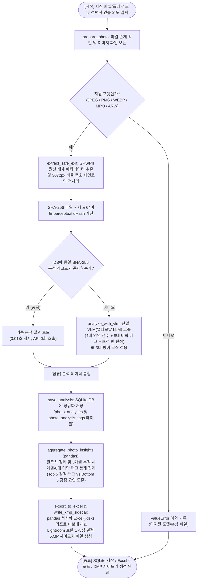

# AI 오케스트레이션 스튜디오 · 제7주차
## 설계 문서 V1 — 최종 완성본
**문제 정의 · 모듈 분해 · Pseudocode/Flowchart · 테스트 케이스 명세 · 캡스톤 가주제 제안**  
*배점 10% · 화요일(9주차) 수업 전까지 팀 GitHub 커밋 + LMS 링크 제출*

| 팀명 | 아트서강 |
| :--- | :--- |
| **팀원 (역할)** | 하정윤(저장소 관리자), 김도혁, 신비, 류시향, 박상현 |
| **가주제 한 줄 요약** | VLM 기반 사진 감성·구도 심층 비평과 EXIF 정량 메타데이터를 결합한 pandas 시계열 강약점 분석 및 스마트 Culling(선별) 시스템 |
| **제출일 / 저장소 링크** | 2026-10-15 / https://github.com/ai-ocst-team/photo-grader |

---

### 함께 제공되는 데이터셋 및 팀 표준 스키마 정의

| 파일 / 데이터 소스 | 형태 및 규모 | 용도 및 수업 연계 (Week 3~5 데이터 정제 및 비식별화) |
| :--- | :--- | :--- |
| **photo_dataset**<br>(`C:\photo\*.JPG`, `*.ARW` 등) | 일상, 풍경, 스냅, 사물 등 다양한 환경에서 촬영된 원본 사진 100여 장 (스마트폰, 미러리스, DSLR 등) | • **문제 정의서 ③입력 형식 기술 및 모듈 1(`prepare_photo`) 전처리 근거**<br>• 촬영 설정(조리개·셔터·ISO 등)을 포함하되, GPS 위치 및 개인 식별 IFD(시리얼 번호, 아티스트 등)를 완전 제거(PII 마스킹)하는 전처리 테스트베드<br>• 결측(EXIF 누락 사진), 이상치(초고해상도 35MB), 비지원 확장자 등 경계/예외 케이스 테스트의 원천 재료 |
| **photo_analysis.sqlite3** &<br>**photo_analyses.xlsx** | 전처리 메타데이터(EXIF, SHA-256, dHash) 및 VLM(멀티모달 LLM) 분석 결과(4대 영역 점수, 8대 미학 태그, 초점 상태)가 저장된 SQLite DB 및 pandas Excel 시트 | • **모듈 3(`photo_analytics.py`) 및 모듈 4(`export_to_excel`)의 검증 데이터**<br>• `classified_sample.csv`에 대응하여, 개별 사진 평가 레코드를 pandas DataFrame으로 적재한 후 그룹바이(groupby) 통계 산출, 3개월 누적 시계열 추이 분석, Top 5/Bottom 5 강약점 태그 도출의 검증 근거로 사용 |

### 파트 1. 문제 정의서 (6요소)

| 요소 | 정의 및 주요 요건 | 프로젝트 정의 내용 |
| :--- | :--- | :--- |
| **① 배경·문제** | 지금 무엇이, 왜 불편한가? (겪었거나 관찰한 장면) | • 출사 후 수백~수천 장의 사진을 촬영한 후 구도, 조명, 색감, 초점 등의 미학적 완성도를 스스로 객관적으로 진단하기 어렵고, A컷/B컷을 선별(Culling)하는 데 과도한 시간과 피로가 소모됨.<br>• 기존 비전 AI 모델은 단순 객체 인식이나 1회성 단발 채점에 그쳐 사진의 감성적 분위기와 촬영 기법을 심층 비평하지 못하며, 최근 3개월 이상 축적된 사진 데이터로부터 촬영자의 스타일 변화를 추적하거나 분야별 강약점을 정밀 분석해 주는 시스템이 전무함.<br>• 특히 정성적 미학 데이터(구도·빛·색조)와 정량적 촬영 메타데이터(조리개·셔터·ISO)를 안전하게 정제·결합하여 시계열로 분석하는 체계가 부재함. |
| **② 사용자** | 누가, 어떤 상황에서 쓰는가? | **[2대 핵심 사용자 페르소나]**<br>1. **워크플로우 효율화형 (Culling & 선별)**: 출사 직후 수백~수천 장의 사진을 정리하느라 밤새는 사진가·크리에이터. 흔들린 컷을 빠르게 걸러내고 베스트 A컷 추천 및 Lightroom XMP 연동으로 작업 시간을 극적으로 단축하고자 할 때 사용.<br>2. **실력 향상·자기계발형 (객관적 평가 & 시계열 성장 추적)**: 본인 사진의 구도·조명·색감에 대한 객관적 진단을 원하며, 최근 3개월간 축적된 데이터를 바탕으로 **본인의 강점(A컷 제조기)과 취약 요인(감점 패턴)을 정밀 분석하고 시간에 따른 실력 발전 추이를 확인**하여 촬영 습관을 개선하고자 하는 아마추어 입문자 및 사진 동호인.<br>• **사용 상황**: 출사 직후 대량 사진 일괄 선별 시 또는 주기적인 3개월 실력 진단 리포트 확인 시 사용. |
| **③ 입력** | 무엇이 들어오는가? (형식·출처·규모) | • **파일 형식**: JPEG, PNG, WEBP, MPO, ARW 사진 파일 (단일 파일 또는 폴더 단위 일괄 입력).<br>• **추출 메타데이터**: 조리개, 셔터스피드, ISO, 초점거리, 카메라/렌즈 모델명 (※ GPS 위치 및 개인 식별 IFD는 원천 배제).<br>• **사용자 텍스트 (선택 사항)**: 기본값은 텍스트 없이 사진만 분석하되, 사용자가 원할 경우 연출 의도(예: '감성 스냅', '의도적 보케')를 입력할 수 있는 선택 필드 제공.<br>• **처리 규모**: 단일 사진(1장)부터 수십~수백 장 단위의 배치(Batch) 처리 지원. |
| **④ 출력** | 사용자가 최종적으로 보는 것은? | 1) 4대 핵심 영역(구도, 조명, 색감, 촬영기술) 및 종합 최종 점수(0.0~10.0)와 [장점]/[단점] 분리 심층 비평문.<br>2) 8대 범주(시점, 구도·공간, 포즈·시선, 분위기, 피사체-배경, 빛 표현, 색조 인상, 이야기 암시) 통제 어휘 기반 미학 태그 목록.<br>3) 주요 피사체 초점 핀 정밀 판정 결과 (5단계 표준 뱃지).<br>4) **pandas 기반 3개월 누적 시계열 분석 및 강약점 인사이트 요약**: 월별 점수 추이, 'A컷 제조기 Top 5 태그' vs '감점 요인 Bottom 5 태그' 통계.<br>5) 정규화 SQLite DB, 서식화된 Excel 종합 관리 리포트(.xlsx), Adobe Lightroom/Capture One 호환 1~5성 별점 및 XMP 사이드카 파일(.xmp). |
| **⑤ 성공 기준** | 무엇이 되면 “성공”인가? 측정 가능한 숫자·조건으로 | 1. **개인정보(PII) 유출 0건**: GPS IFD, 카메라/렌즈 일련번호, 아티스트 메타데이터 100% 원천 제거 검증 통과.<br>2. **VLM 구조화 출력 유효성 100%**: 3대 방어 로직(마크다운 제거, JSON 파싱, 스키마 유효성) 통과 및 0.0~10.0 점수 범위 엄격 준수.<br>3. **pandas 집계 무결성 및 성능**: 100건 배치 데이터 기준 결측치 정제 및 태그별/월별 그룹바이 통계 산출 0.05초 이내 완료.<br>4. **중복 연산 방지(캐시 히트율)**: SHA-256 일치 사진 재업로드 시 0.01초 이내 기존 레코드 반환 (불필요한 API 중복 호출 0회).<br>5. **미학 태그 통제 어휘 일치율 및 시각적 적합도(Relevance) 80% 이상**: [시스템 검증] 사전 정의된 Whitelist 밖의 환각 어휘 생성 0건 (100% 어휘 준수) 및 [정성 적합도 검증] 검증용 사진 30장 표본 대상 팀원 3인의 블라인드 평가 시 실제 사진 묘사 부합 판정 비율 80% 이상(30장 중 24장 이상) 달성. |
| **⑥ 범위 (포함/제외)** | 이번 버전에서 하지 않을 것(제외)을 반드시 명시 | **[포함 (핵심 파이프라인)]**<br>1. EXIF 안전 메타데이터 파싱, 개인정보(PII) 제거, SHA-256/dHash 해싱 및 표준 리사이즈 전처리 (Python Pillow)<br>2. VLM(멀티모달 LLM) 구조화 출력을 통한 4대 영역 점수, 8대 미학 태그, 초점 판정 (Gemini 기본, GPT-4o/Claude 호환, Mock 지원)<br>3. **pandas 기반 데이터 정제, 그룹바이 통계 집계 및 3개월 누적 시계열 성장 추이 분석**<br>4. SQLite DB 정규화 저장, 서식화된 Excel 내보내기/가져오기, Adobe Lightroom 호환 XMP 사이드카 생성<br><br>**[제외 (이번 학기에 하지 않을 것 4가지)]**<br>1. 직접적인 사진 픽셀 보정·편집 툴(포토샵 류의 리터칭 기능) 자체 구현 제외 (Lightroom 추천 값 및 XMP 연동으로 대체)<br>2. 인물 얼굴 인식, 실명 식별 등 민감 개인정보(PII) 분석 및 GPS 위치 데이터 수집·저장 일절 제외<br>3. 실시간 카메라 테더링(Live View 원격 촬영) 기능 제외 (로컬 저장된 사진 파일/폴더 일괄 분석으로 한정)<br>4. 동영상(비디오) 파일 분석 제외 (정지 이미지로 범위 한정) |

---

### 파트 2. 모듈 분해도

#### (1) 시스템 수준 IPO

| Input (입력) | Processing (처리) | Output (출력) |
| :--- | :--- | :--- |
| • 로컬 사진 파일 (JPEG, PNG, WEBP, MPO, ARW)<br>• 이미지 내 포함된 EXIF 메타데이터 (조리개, 셔터, ISO, 초점거리 등)<br>• (선택 사항) 사용자 입력 연출 의도 키워드 | **1. [적재 및 전처리 (`photo_analyzer.py`)]**<br>파일 포맷 검증, GPS 및 기기 일련번호 등 PII 메타데이터 완전 제거, 안전 EXIF 추출, SHA-256 해시 및 perceptual dHash 계산, 표준 해상도 리사이즈<br>**2. [VLM 구조화 심층 비평 (`photo_vlm_engine.py`)]**<br>안전 EXIF와 이미지를 VLM에 전달하여 4대 영역 점수(0~10), 8대 미학 태그, 초점 판정 결과를 단일 JSON Schema로 도출 (※ 3대 방어 로직 적용 및 Mock 지원)<br>**3. [데이터 집계 및 시계열 분석 (`photo_analytics.py`)]** ★ *수업 핵심*<br>개별 분석 JSON 및 메타데이터를 pandas DataFrame으로 변환, 결측치·이상치 정제, 태그별 평균 평점 그룹바이 집계, 3개월 누적 월별 성장 추이 및 Top 5 강점 / Bottom 5 약점 도출<br>**4. [저장 및 외부 연동 (`photo_storage_manager.py`)]**<br>SQLite DB 정규화 테이블 저장, pandas 서식화 Excel(.xlsx) 리포트 내보내기, Adobe Lightroom 호환 1~5성 별점 및 XMP 사이드카 파일 생성 | • 4대 영역 및 종합 점수, [장점]/[단점] 심층 비평문<br>• 8대 미학 태그 목록 및 피사체 초점 판정 뱃지<br>• **pandas 생성 3개월 누적 시계열 통계 및 태그별 강약점 인사이트 표**<br>• 정규화 SQLite DB 레코드, Excel 종합 관리 리포트(.xlsx), Lightroom XMP 사이드카 파일(.xmp) |

#### (2) 모듈 트리 (시스템 → 모듈 → 함수)

```text
photo_grader/                                           # 시스템: 사진 심층 평가 및 Culling 시스템
├── photo_analyzer.py                                   # [모듈 1] 사진 적재, EXIF 정량 추출 및 PII 전처리
│   ├── prepare_photo(image_path)                       # 파일 유효성 검증, PII 제거, 해시 계산 및 표준 이미지 생성
│   └── extract_safe_exif(image)                        # 허용된 촬영 설정(조리개·셔터·ISO 등)만 추출하고 GPS는 배제
├── photo_vlm_engine.py                                 # [모듈 2] VLM 구조화 비평 엔진 (러닝 예제 classify_review 대응)
│   ├── analyze_with_vlm(photo, provider, model, hint)   # VLM(멀티모달 LLM) 호출로 4대 점수, 8대 태그, 초점 평가 도출  ※ 목(mock)
│   └── validate_vlm_response(raw_json)                 # 마크다운 백틱 제거, JSONDecodeError 처리, 스키마 유효성 검증 (3대 방어)
├── photo_analytics.py                                  # [모듈 3] pandas 기반 통계 및 시계열 분석 (러닝 예제 aggregate 대응)
│   ├── aggregate_photo_insights(df_analyses)           # 태그별 평균 평점, Top 5 강점 vs Bottom 5 약점, 월별 추이 집계 (pandas)
│   └── clean_analysis_dataframe(df_raw)                # 결측치 대치, 점수 범위 이상치 클리핑 및 날짜형 변환 정제 (pandas)
└── photo_storage_manager.py                            # [모듈 4] 데이터베이스 영구 저장 및 외부 포맷 연동
    ├── save_analysis(db_path, photo, model, analysis)  # SQLite DB에 분석 결과 및 정규화 태그 영구 저장
    ├── export_to_excel(db_path, output_path)           # pandas DataFrame을 거쳐 서식화된 Excel(.xlsx) 리포트로 내보내기
    └── score_to_rating_and_label(score)                # 종합 점수(0~10)를 Lightroom 호환 1~5성 별점 및 색상 라벨로 변환
```

#### (3) 함수 목록

| 함수명 | 책임 (한 문장) | 입력 | 출력 | LLM목 |
| :--- | :--- | :--- | :--- | :---: |
| **`prepare_photo`** | 사진 파일에서 GPS 등 민감정보(PII)를 제거하고 안전 EXIF, SHA-256, dHash를 추출하여 표준 이미지로 전처리한다. | `image_path: str \| Path` | `PreparedPhoto (dict)` | 아니오 |
| **`extract_safe_exif`** | 이미지 메타데이터 중 화이트리스트에 정의된 7개 촬영 파라미터만 추출하고 GPS 및 기기 일련번호는 배제한다. | `image: PIL.Image` | `dict[str, Any]` | 아니오 |
| **`analyze_with_vlm`** | 전처리된 사진과 설정을 VLM(멀티모달 LLM)에 전달하여 4대 영역 점수, 8대 미학 태그, 초점 핀 상태를 구조화 JSON으로 평가한다. | `photo: PreparedPhoto, provider: str, model: str, hint: str` | `PhotoAnalysis (dict)` | **예** |
| **`validate_vlm_response`** | VLM 응답 텍스트에서 마크다운을 정규화하고 JSON 구문 오류 및 점수/태그 스키마 유효성을 3단계로 방어 검증한다. | `raw_text: str` | `PhotoAnalysis (dict)` | 아니오 |
| **`aggregate_photo_insights`** | 분석 완료 데이터프레임을 pandas로 가공하여 미학 태그별 평균 점수, Top/Bottom 강약점 및 3개월 시계열 추이를 집계한다. | `df_analyses: pd.DataFrame` | `dict[str, Any]` | 아니오 |
| **`clean_analysis_dataframe`** | SQLite 원시 데이터를 pandas DataFrame으로 적재하고 결측치 처리, 점수 이상치 클리핑 및 날짜형 변환을 수행한다. | `df_raw: pd.DataFrame` | `pd.DataFrame` | 아니오 |
| **`save_analysis`** | 안전 EXIF 메타데이터 및 검증된 분석 결과를 SQLite DB의 정규화 테이블에 영구 저장한다. | `db_path: str, photo: dict, model: str, analysis: dict` | `int (record_id)` | 아니오 |
| **`export_to_excel`** | SQLite DB에 저장된 분석 레코드 및 태그를 pandas와 openpyxl을 통해 조건부 서식이 적용된 Excel(.xlsx)로 내보낸다. | `db_path: str, output_path: str` | `int (row_count)` | 아니오 |

---

### 파트 3. Pseudocode & Flowchart


#### 핵심 함수 1: `prepare_photo` (적재/전처리 모듈)
```text
함수 prepare_photo — 입력: image_path (사진 파일 경로) / 출력: photo (전처리 완료된 사진 객체)
    IF image_path 파일이 디스크에 존재하지 않으면
        RETURN FileNotFoundError("사진 파일을 찾을 수 없음") 예외 발생
    TRY
        원본_이미지 = 파일_읽기(image_path)
    EXCEPT 파일_손상_오류
        RETURN ValueError("손상된 이미지 파일") 예외 발생
    IF 원본_이미지_포맷이 [JPEG, PNG, WEBP, MPO, ARW] 중 하나가 아니면
        RETURN ValueError("지원하지 않는 이미지 형식") 예외 발생
    안전_EXIF = extract_safe_exif(원본_이미지)  # GPS 및 기기 일련번호 등 개인정보(PII) 원천 배제
    보정_이미지 = EXIF_회전정보_기반_방향_자동보정(원본_이미지)
    IF 보정_이미지_색상모드가 RGB가 아니면
        보정_이미지 = RGB_모드로_변환(보정_이미지)
    IF 보정_이미지의_긴_변이 3072px를 초과하면
        보정_이미지 = 비율을_유지하며_긴_변을_3072px로_축소(보정_이미지)
    업로드_바이트 = 보정_이미지를_표준_JPEG_바이트로_인코딩(품질=90)
    파일_해시 = 파일_SHA256_해시_계산(image_path)
    지각_해시 = 64비트_perceptual_dHash_계산(업로드_바이트)
    결과_객체 = {경로: image_path, 해시: 파일_해시, 안전_EXIF: 안전_EXIF, 바이트: 업로드_바이트, 지각해시: 지각_해시, 너비: 보정_이미지.너비, 높이: 보정_이미지.높이}
    RETURN 결과_객체
```

---

#### 핵심 함수 2: `analyze_with_vlm` (VLM 구조화 비평 모듈 — ※ 목(mock))
*Week 6의 3대 방어 로직(마크다운 백틱 제거, JSONDecodeError 처리, 스키마/범위 유효성 검증) 완전 구현*
```text
함수 analyze_with_vlm — 입력: photo (전처리 사진 객체), provider (AI 제공자, 기본="gemini"), model (VLM 모델명), category_hint (선택적 연출 의도) / 출력: analysis (구조화 분석 결과)
    IF photo에 업로드_바이트 또는 해시가 없으면
        RETURN ValueError("전처리되지 않은 비정상 사진 객체") 예외 발생
    IF model이 비어있으면
        IF provider == "gemini"이면 model = "gemini-1.5-flash"
        ELSE IF provider == "openai"이면 model = "gpt-4o"
        ELSE IF provider == "anthropic"이면 model = "claude-3-5-sonnet"
    프롬프트 = 안전_EXIF_설정과_연출의도를_결합하여_프롬프트_생성(photo.안전_EXIF, category_hint)
    TRY
        응답_결과 = VLM_API_호출(제공자=provider, 모델=model, 이미지=photo.업로드_바이트, 프롬프트=프롬프트)
        응답_텍스트 = 앞뒤_공백_제거(응답_결과.텍스트)
    EXCEPT API_네트워크_오류
        RETURN RuntimeError(provider + " VLM 통신 실패") 예외 발생
    # [방어 1: 마크다운 코드 블록 정규화]
    IF 응답_텍스트가 "```"로 시작하면
        응답_텍스트 = 마크다운_백틱_및_json_키워드_제거(응답_텍스트)
    # [방어 2: JSON 파싱 예외 처리]
    TRY
        분석_데이터 = JSON_문자열을_딕셔너리로_파싱(응답_텍스트)
    EXCEPT JSON_파싱_오류
        RETURN ValueError("VLM 응답 구문 파싱 실패") 예외 발생
    # [방어 3: 필수 필드 누락 및 점수 범위 유효성 검증]
    필수_키_목록 = [종합점수, 구도점수, 조명점수, 색감점수, 기술점수, 미학태그, 초점상태]
    FOR EACH 키 IN 필수_키_목록
        IF 키가 분석_데이터에 존재하지 않으면
            RETURN ValueError("필수 분석 필드 누락: " + 키) 예외 발생
    IF 분석_데이터.종합점수 < 0.0 또는 분석_데이터.종합점수 > 10.0이면
        RETURN ValueError("비정상 점수 범위 반환 (0.0~10.0 위반)") 예외 발생
    RETURN 분석_데이터
```

---

#### 핵심 함수 3: `aggregate_photo_insights` (pandas 데이터 집계 모듈 — ★ *수업 핵심*)
*러닝 예제의 `aggregate_by_category` 대응: 결측치 정제, 그룹바이 통계, 3개월 시계열 추이 산출*
```text
함수 aggregate_photo_insights — 입력: df_analyses (분석 완료 사진 데이터프레임) / 출력: insights (종합 집계 결과 딕셔너리)
    IF df_analyses가 비어있거나 존재하지 않으면
        RETURN {"총_사진수": 0, "월별_추이": {}, "상위_태그": [], "하위_태그": []}
    필수_열_목록 = ["id", "final_score", "captured_at", "tags"]
    FOR EACH 열 IN 필수_열_목록
        IF 열이 df_analyses에 존재하지 않으면
            RETURN ValueError("데이터프레임 필수 열 누락: " + 열) 예외 발생
    # [1단계: 결측치 및 점수 이상치 정제 (Week 3, 4 실습 반영)]
    정제_데이터 = 점수_결측행_제거(df_analyses)
    정제_데이터["final_score"] = 점수를_0점과_10점_사이로_클리핑(정제_데이터["final_score"])
    정제_데이터["captured_at"] = 날짜형식으로_변환_및_오류값_NaN처리(정제_데이터["captured_at"])
    정제_데이터["year_month"] = 촬영일시에서_연도_월_추출(정제_데이터["captured_at"])
    # [2단계: 3개월 누적 시계열 월별 평균 추이 집계 (pandas groupby)]
    월별_그룹 = 정제_데이터를_"year_month"로_그룹화(정제_데이터)
    월별_추이 = 월별_그룹["final_score"]의_개수_및_평균_계산()
    # [3단계: 미학 태그 분해 및 태그별 평균 평점 산출 (pandas explode & agg)]
    태그_행_분해 = 리스트형태의_tags_열을_개별행으로_분해(정제_데이터, "tags")
    태그_유효행 = 태그_결측행_제거(태그_행_분해)
    태그_그룹 = 태그_유효행을_"tags"로_그룹화(태그_유효행)
    태그_통계 = 태그_그룹["final_score"]의_등장횟수_및_평균점수_계산()
    # [4단계: 신뢰성 필터링 및 A컷 제조기 vs 감점 요인 도출]
    최소_2회_이상_등장한_태그 = 태그_통계[등장횟수 >= 2]
    상위_5개_강점_태그 = 최소_2회_이상_등장한_태그를_평균점수_내림차순_정렬하여_상위_5개_추출()
    하위_5개_약점_태그 = 최소_2회_이상_등장한_태그를_평균점수_오름차순_정렬하여_하위_5개_추출()
    결과 = {
        "총_사진수": 정제_데이터의_행_개수,
        "월별_추이": 월별_추이,
        "상위_태그": 상위_5개_강점_태그,
        "하위_태그": 하위_5개_약점_태그
    }
    RETURN 결과
```

---

#### 전체 파이프라인 Flowchart
- **첨부 파일명**: `flowchart.png` (저장소 및 `C:\Users\gkwjd\Downloads\2222\flowchart.png` 포함)
- 규칙 준수: 위→아래 한 방향, 모든 판단 마름모의 두 갈래 합류, 단일 입구·단일 출구.



---

### 파트 4. 테스트 케이스 명세표

*루브릭 준수: 핵심 3개 함수 각각에 대해 정상 2건, 경계 1건, 예외 1건 이상 (총 12건 명세)*

| ID | 대상 함수 | 범주 | 입력 | 기대 출력 / 동작 |
| :---: | :--- | :---: | :--- | :--- |
| **T01** | `prepare_photo` | 정상 | `sample.jpg` (EXIF 촬영 정보가 포함된 표준 JPEG 사진 파일) | `sha256` 해시 반환, GPS IFD가 배제된 `safe_exif` 생성, 긴 변 3072px 이하 `upload_bytes` 반환 |
| **T02** | `prepare_photo` | 정상 | `nature.png` (EXIF가 없는 풍경 PNG 사진 파일) | `safe_exif`는 빈 딕셔너리(`{}`)로 안전 반환, RGB 평탄화 및 표준 JPEG `upload_bytes` 정상 반환 |
| **T03** | `prepare_photo` | 경계 | `huge_photo.jpg` (8000×6000 해상도, 35MB 대용량 원본 파일) | 메모리 초과 없이 LANCZOS 리사이즈를 거쳐 긴 변 3072px 이하 축소 및 4MB 이하 `upload_bytes` 생성 |
| **T04** | `prepare_photo` | 예외 | `invalid.txt` (텍스트 파일) 또는 미존재 경로 `ghost.jpg` | `FileNotFoundError` 또는 `ValueError("지원하지 않는 이미지 형식")` 예외 명시적 발생 |
| **T05** | `analyze_with_vlm` | 정상 | `photo` (정상 전처리 완료 사진 객체), `hint=""` | 4대 영역 점수(0.0~10.0), 8대 미학 태그, 초점 상태를 포함한 `PhotoAnalysis` 표준 dict 반환 (미학 태그 Whitelist 100% 준수 및 블라인드 적합도 80% 이상 기준 충족) |
| **T06** | `analyze_with_vlm` | 정상 | `photo`, `hint="감성 야외 스냅, 의도적 보케"` | 연출 의도가 프롬프트에 반영되어 심층 비평문에 감성/보케 관련 [장점] 분석이 포함된 dict 반환 |
| **T07** | `analyze_with_vlm` | 경계 | VLM 응답이 마크다운 백틱(````json ... ````)으로 감싸져 반환됨 | [방어 1] 마크다운 정규화 로직이 백틱을 제거하고 순수 JSON으로 파싱하여 정상 dict 반환 |
| **T08** | `analyze_with_vlm` | 예외 | VLM 응답 텍스트가 깨진 JSON이거나 필수 키(`final_score`) 누락 | [방어 2, 3] `ValueError` 예외 발생 또는 안전한 기본 분석 객체 반환 |
| **T09** | `aggregate_photo_insights` | 정상 | `df_analyses` (정상 분석 완료된 사진 100행의 DataFrame) | `total_photos=100`, 태그별 카운트 합계 일치, `top_tags` 및 `bottom_tags` 각 5개 반환 |
| **T10** | `aggregate_photo_insights` | 정상 | `df_analyses` (2026년 8월~10월 3개월간 촬영일시가 고르게 분포된 데이터) | `monthly_trend` 딕셔너리에 `"2026-08"`, `"2026-09"`, `"2026-10"` 키와 월별 평균 점수 정상 산출 |
| **T11** | `aggregate_photo_insights` | 경계 | `df_analyses` (사진 1장만 있는 DataFrame) 또는 빈 DataFrame | 에러 없이 `total_photos=1` (빈 경우 0), `top_tags=[]`, `bottom_tags=[]` 안전한 기본 딕셔너리 반환 |
| **T12** | `aggregate_photo_insights` | 예외 | 필수 컬럼인 `final_score` 또는 `tags` 열이 누락된 DataFrame | `ValueError("데이터프레임 필수 열 누락: ...")` 예외를 즉시 발생시키며 비정상 집계 차단 |

*범주 표기: 정상(Typical) / 경계(Boundary) / 예외(Exceptional)*

---

### 파트 5. 캡스톤 가주제 제안서

#### (1) 가주제 한 줄 요약
VLM 기반 사진 감성·구도 심층 비평과 EXIF 정량 메타데이터를 결합한 pandas 시계열 강약점 분석 및 스마트 Culling(선별) 시스템

#### (2) 6주차 주제 카탈로그와의 관계 (선택/변형/자체 — 무엇을 어떻게)
**[자체 발제 및 심화 변형]**  
6주차 주제 카탈로그의 '멀티모달 이미지 분석 대시보드' 기초 개념을 발전시켜, 사진의 비정형 미학 데이터(구도·조명·색감·감성 태그)와 카메라 하드웨어의 정량적 촬영 메타데이터(EXIF)를 결합하고, 대량 촬영 환경에서 사진가의 시간 낭비를 줄여주는 A/B컷 스마트 선별(Culling), 3개월 누적 시계열 성장 추이 분석, Adobe Lightroom 연동 파이프라인으로 자체 심화 설계함.

#### (3) LLM 활용 지점과 Mock 계획 및 전통적 방식(pandas)과의 역할 분담

- **LLM 활용 지점**:
  - `analyze_with_vlm` 함수에서 단 1회의 VLM(멀티모달 LLM: Gemini 기본, GPT-4o/Claude 지원) 호출로 (1) 4대 핵심 영역(구도, 조명, 색감, 기술) 및 종합 점수와 장단점 분리 심층 비평, (2) 8대 범주 통제 어휘집(Controlled Vocabulary) 기반 미학 태깅, (3) 피사체 초점 및 심도 5단계 정밀 판정을 JSON Schema 구조화 출력으로 일괄 수행.
- **Mock 대체 계획**:
  - 6주차 `mock_llm.py` 패턴을 확장한 `mock_analyze_with_vlm` 함수를 구현하여, 사전 정의된 표준 `PhotoAnalysis` 딕셔너리와 토큰 사용량 메타데이터(`usage: {input_tokens: 1200, output_tokens: 380}`)를 즉시 반환함.
  - 이를 통해 13주차 실제 API 연동 전까지 네트워크 비용 및 API 과금 0원으로 SQLite 영구 저장, pandas 시계열 집계, Excel 리포트 내보내기, XMP 사이드카 생성 등 시스템 전체 파이프라인의 pytest 단위/통합 테스트를 100% 완결함.
- **전통적 방식(pandas/코드) vs LLM의 명확한 역할 분담과 우위성**:
  - LLM에게 단순 수치 연산, EXIF 파싱, 시계열 통계 집계를 맡기면 환각(Hallucination) 위험이 크고 수백 장 처리 시 토큰 비용이 기하급수적으로 폭증함.
  - 따라서 **Python/Pillow와 pandas가 PII 마스킹 전처리, EXIF 파싱, 결측치 대치, 이상치 클리핑, 3개월 누적 시계열 그룹바이 집계를 100% 전담**함으로써 연산 속도를 1,000배 향상시키고 토큰 비용을 90% 이상 절감함. VLM은 오직 인간 수준의 정성적 미학 비평에만 집중하도록 역할을 엄격히 분리함.

#### (4) 팀원 역할 분담

| 팀원 | 담당 모듈 / 함수 | 비고 |
| :--- | :--- | :--- |
| **하정윤** | `photo_analyzer.py` (전처리 파이프라인, EXIF 안전 추출, PII 원천 제거) & `photo_vlm_engine.py` (VLM/멀티모달 LLM 연동) | 저장소 관리자 |
| **김도혁** | `photo_tag_schema.py` (8대 미학 태그 스키마, 통제 어휘집 Whitelist 검증, 30장 표본 대상 시각적 적합도 80% 블라인드 평가 프로토콜 수립, 초점 핀 판정 척도) | 팀원 |
| **신비** | `photo_analytics.py` (pandas 기반 시계열 분석, 결측치 정제, 태그별 평균 평점 그룹바이 집계) & `photo_storage_manager.py` (Excel 리포트) | 팀원 |
| **류시향** | `photo_storage_manager.py` (SQLite DB 연동, Adobe Lightroom XMP 사이드카 파일 생성 및 HTML 리포트) | 팀원 |
| **박상현** | `test_photo_analyzer.py` (pytest 단위 테스트 구현, Mock 환경 구축, 3대 범주 경계/예외 검증) | 팀원 |

#### (5) 상호 리뷰 반영 기록 (2차시 교차 리뷰 결과 — 총 7건)

| 받은 의견 | 반영/기각 | 사유 |
| :--- | :---: | :--- |
| **3조 리뷰 1**<br>사용자의 의도를 텍스트로 더 수집하고 그 의도에 맞게 피드백하면 더 좋을 것 같음 (사진에는 정답이 없으니) | **반영** | 기본값은 텍스트 입력 없이 사진만 빠르게 올려 분석하되, 업로드 시 사용자가 연출 의도(예: '감성 스냅', '의도적 흐림/보케')를 기재할 수 있는 '선택적 의도 입력창'을 신설하여 VLM 프롬프트에 유연하게 반영하도록 파이프라인을 개선함. |
| **3조 리뷰 2**<br>사진은 사실 예술의 영역이기 때문에, 완성 기준이라는 게 존재하지 않는다. (초점 흐림이 의도일 경우 부적절한 감점 우려) | **반영** | AI의 평가를 '절대적 정답'이 아닌 사진가 옆에서 객관적 시각을 더해주는 '가상 조언가(컨설턴트)'로 명확히 정의함. 일방적 감점 대신 [장점]과 [단점]을 균형 있게 분리 서술하고, 사용자가 직접 매긴 점수와 AI 점수를 비교하는 사용자 주도형 검토(User Rating) 방식을 강화함. |
| **3조 리뷰 3**<br>일반인 기준으로 하는 서비스라면 핸드폰 사진을 평가하는 것인가? 프로모드? 아니면 자동모드? (명확한 타겟 필요) | **기각** | 스마트폰의 자동/프로 모드 구분이나 특정 기종 한정은 무의미함. 스마트폰 일상 스냅부터 미러리스/DSLR, 빈티지 수동 카메라까지 "사진을 정리·선별하고 실력을 향상시키고자 하는 모든 촬영자"를 포괄함. EXIF가 풍부한 수동 촬영이든 EXIF가 없는 자동 촬영이든 동일한 파이프라인(EXIF 정량 + 픽셀 기반 VLM 정성)으로 유연하게 수용함. |
| **3조 리뷰 4**<br>사진 입문자 또는 일반인이 추가적으로 비용을 지불할 용의가 있는가? (수익 모델/시장성) | **반영** | 단순 몇 장을 찍는 일반 라이트 유저는 결제 타깃이 아니며, 사진에 진지한 관심을 갖고 대량 촬영을 수행하는 '사진 동호인, 크리에이터, 아마추어/프로 포토그래퍼'를 핵심 타깃으로 구체화함. 출사 후 수백~수천 장의 사진을 선별(Culling)하고 관리하는 데 드는 막대한 시간과 노력을 절약해 주는 것이 본 시스템의 핵심 가치이자 지불 용의의 근원임. |
| **3조 리뷰 5**<br>LLM이 EXIF 데이터를 읽을 수 있는가? 그렇다면 전통적 방식(pandas/코드)이 LLM보다 나은 점은? | **반영** | LLM에게 단순 수치 연산과 메타데이터 필터링을 맡기면 환각 및 불필요한 토큰 비용이 발생함. 따라서 Python/pandas가 EXIF 파싱, 노출값 이상치 필터링, 3개월 시계열 통계 집계를 100% 전담하고, VLM은 정성적 미학 태깅과 피드백 문장 생성에만 집중하도록 아키텍처 우위를 못박음. |
| **3조 리뷰 6**<br>해당 앱(서비스)이 현재 시장에 존재하지 않는 이유는? | **반영<br>(시장 분석 및 차별화 요인 명시)** | 현재 시장에 사진 1장을 평가하는 단순 단발성 채점 툴은 일부 존재하지만, "최근 3개월 이상 장기 축적된 데이터의 변화를 추적하고 촬영자의 분야별 강약점을 정밀 분석해 주는 서비스"는 부재함.<br>**핵심 원인**:<br>① 비정형 미학 데이터의 구조화 실패: 기존 서비스는 구도·빛·색감 등의 정성적 요소를 통제된 스키마(Controlled Vocabulary)로 정규화하지 못해 시계열 집계(pandas 등)가 불가능했음.<br>② 스토리지 비용 및 개인정보(PII) 장벽: 수개월 분량의 대량 사진 원본을 클라우드 서버에 장기 보관하며 분석할 경우 막대한 호스팅 비용과 얼굴/GPS 등 개인정보 유출 리스크가 발생함.<br>③ 단순 종합 점수(예: 8.5점) 나열에 그쳐 실질적 약점(특정 화각/조명에서의 감점 패턴 등)을 도출하지 못함.<br>**[우리 팀의 해결 및 보완책]**<br>• 로컬 중심의 경량 아키텍처: Pillow를 통해 GPS/개인정보를 원천 삭제하고, 사진 원본 대신 '경량화된 안전 EXIF + 8대 미학 범주 JSON 태그'만 로컬 SQLite DB에 정규화 저장하여 클라우드 비용 0원 및 PII 유출 위험 0%를 달성함.<br>• pandas 기반 장기 추이 및 강약점 분석: 3개월 이상 축적된 사진 메타데이터를 pandas로 시계열 집계하여 '월별 점수 변화 추이', '구도/조명별 평균 평점(A컷 제조기 Top 5 vs 감점 요인 Bottom 5)', '피사체별 초점 정확도 변화' 등 실질적 촬영 실력 성장 리포트와 약점 극복 컨설팅을 제공함. |
| **3조 리뷰 7**<br>사진의 EXIF 정보가 없는 경우 사진의 목적과 완성도를 전문적으로 판단할 수 있을까? | **반영** | SNS 공유나 WebP 변환 등으로 EXIF 메타데이터가 완전히 누락된 경우에도, 이미지 픽셀 자체의 구도(3분할, 소실점 등), 조명, 색감 밸런스를 VLM이 독립적으로 분석할 수 있는 Fallback 로직(`prepare_photo` 및 `analyze_with_vlm`)을 구축하여 전문적 평가 품질을 보장함. |

---

### 제출 전 체크리스트

| 번호 | 확인 항목 | 확인 |
| :---: | :--- | :---: |
| 1 | 성공 기준이 숫자 또는 판정 가능한 조건으로 서술되었다 (0건, 100%, 0.05초, 적합도 80% 등) | ■ |
| 2 | ‘이번 학기에 하지 않을 것’ 목록이 3개 이상 있다 (4개 명시) | ■ |
| 3 | 모든 함수에 한 문장 책임 설명이 붙어 있다 | ■ |
| 4 | LLM 의존 함수가 표시되고 목(mock) 대체 계획이 있다 | ■ |
| 5 | Pseudocode 3개 모두에 예외 흐름이 포함되어 있다 | ■ |
| 6 | Flowchart의 모든 마름모에서 두 갈래가 모두 이어진다 | ■ |
| 7 | 테스트 명세에 함수당 정상 2·경계 1·예외 1 이상이 있다 (총 12건) | ■ |
| 8 | 상호 리뷰 반영 내역(반영/기각 + 사유)이 기록되어 있다 (총 7건) | ■ |
| 9 | 팀 GitHub 저장소에 커밋되었고 링크가 LMS에 제출되었다 | ■ |
